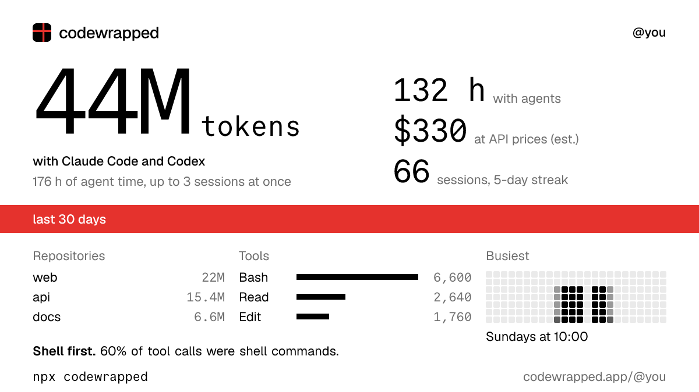

# codewrapped

Your month with coding agents, on one card. One command reads your coding agent logs on your computer and makes a shareable card: tokens, hours, repositories, tools and when you work. Works with Claude Code, Codex, Pi (beta), opencode (beta) and ZCode (beta).

```sh
npx codewrapped
```

<picture>
  <source media="(prefers-color-scheme: dark)" srcset="docs/card-dark.png">
  
</picture>

Example card with made-up numbers. Yours comes from your own logs.

## What you get

Run the command and you get `codewrapped.png` and a summary in the terminal:

- Tokens, without cache reads, and what they would cost at public API prices (an estimate)
- Hours with agents, counted on the wall clock, plus agent time when sessions run in parallel
- Sessions, prompts and your longest streak
- Top repositories, most edited files and favorite tools
- When you work, as a weekday by hour heatmap
- An archetype, such as Night shift or Shell first

## Private by default

- **What it reads:** session logs in `~/.claude`, `~/.codex`, `~/.pi/agent`, `~/.local/share/opencode`, `~/.zcode/cli/db` and any other Claude Code or Codex folders it finds (see [SECURITY.md](SECURITY.md) for exactly where it looks), and from `.git/config` only the repository name from the remote URL, never credentials.
- **What it counts:** time, tokens, tool calls, file and repository names.
- **What it never keeps:** your prompts, your code, full paths.
- **Without an account:** it makes zero network requests.

Several Claude Code accounts, such as `~/.claude` and `~/.claude-work`, are found and added up automatically. Folders elsewhere: pass `--claude-dir`, `--codex-dir`, `--pi-dir`, `--opencode-dir` or `--zcode-dir`. Several computers: run `npx codewrapped sync` on each and the totals add up on your profile.

## Keep your history

Claude Code deletes logs after 30 days. Sign in at [codewrapped.app](https://codewrapped.app) and sync, and your history keeps growing. You also get a public page at `codewrapped.app/@you` and a spot on the leaderboard if you want one.

```sh
npx codewrapped login   # connect this computer in the browser
npx codewrapped sync    # upload daily totals
npx codewrapped logout
```

The first sync shows what will be uploaded and asks before sending. `npx codewrapped sync --dry-run` prints the exact upload and sends nothing. File and repository names stay off your public page until you turn them on.

## Options

```
--period 7d|30d|90d|year|all    Period to show (default 30d)
--source claude|codex|pi|opencode|zcode|all
                                Which agent to include
--theme light|dark              Card theme
--story                         Story size card, 1080x1920
--out <path>                    Where to write the card
--hide-files, --hide-repos      Leave names out of the card and uploads
--include-automated             Count claude -p, Agent SDK and codex exec runs in hours
--json                          Print the summary as JSON
--claude-dir, --codex-dir, --pi-dir, --opencode-dir, --zcode-dir
                                Read logs from these folders instead
```

Logs are found in `$CLAUDE_CONFIG_DIR`, `~/.claude`, `~/.config/claude`, `$CODEX_HOME` and `~/.codex`. A log in more than one folder is counted once.

## How the numbers are counted

- **Hours** are minutes when at least one session was active, with gaps over 5 minutes left out. Parallel sessions count once. Their sum is shown as agent time.
- **Tokens** are input, output and cache writes. Cache reads are listed separately because they are most of the total and would hide everything else.
- **Cost** uses public API prices for every token type, checked on the date in `packages/stats/src/pricing.ts`. Subscription plans are billed differently.
- **Automated runs** (`claude -p`, the Agent SDK, `codex exec`) count in tokens and tools, not in hours, unless you pass `--include-automated`.
- **The leaderboard** is self-reported from local logs. It ranks wall-clock hours, streaks and tokens, never cost, and only shows people who opted in.

## Repository

| Path | What it is |
|---|---|
| `apps/cli` | The `codewrapped` npm package |
| `apps/api` | Hono API on Node with Postgres, deployed with Docker. See [apps/api/README.md](apps/api/README.md) |
| `apps/web` | Next.js site. See [apps/web/README.md](apps/web/README.md) |
| `packages/parser` | One adapter per coding agent (Claude Code, Codex, Pi, opencode, ZCode) that reads its logs into daily totals. To add one, see [CONTRIBUTING.md](CONTRIBUTING.md#adding-a-harness) |
| `packages/stats` | Summaries, archetypes, pricing. Shared by the CLI, API and site, so numbers match everywhere |
| `packages/card` | The card, rendered with satori |
| `packages/brand` | Colors, fonts and the mark |

```sh
pnpm install
pnpm test
pnpm build
pnpm cli          # build the CLI and run it on your logs
```

Requires Node 20.12 or newer.

## Not affiliated

codewrapped is an independent project. It is not affiliated with or endorsed by Anthropic or OpenAI. Claude and Claude Code are trademarks of Anthropic. Codex is a trademark of OpenAI.

Fonts: [Geist](https://vercel.com/font) and [Commit Mono](https://commitmono.com), both under the SIL Open Font License.
