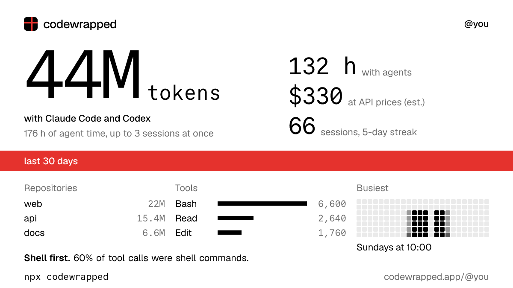

# codewrapped

Your month with coding agents, on one card. Reads your coding agent logs on your computer and makes a shareable card: tokens, hours, repositories, tools and when you work. Works with Claude Code, Codex, Pi (beta), opencode (beta), ZCode (beta), Cursor (beta) and oh-my-pi (beta).

```sh
npx codewrapped
```



- **What it reads:** session logs in `~/.claude`, `~/.codex`, `~/.pi/agent`, `~/.local/share/opencode`, `~/.zcode/cli/db`, Cursor's chat database, `~/.omp/agent` and any other Claude Code or Codex folders it finds in `~` and `~/.config`. From your shell config files it keeps only the paths in `CLAUDE_CONFIG_DIR`, `CODEX_HOME`, `PI_CODING_AGENT_DIR`, `ZCODE_SESSION_DB_PATH` and `ZCODE_SESSION_DB`. From `.git/config` it keeps only the repository name from the remote URL, never credentials. [SECURITY.md](https://github.com/SergeyGalaxyOrsik/codewrapped/blob/main/SECURITY.md) lists exactly where it looks.
- **What it never uploads:** your prompts, your code, full paths. The list of log folders it found stays in `~/.config/codewrapped/config.json` on your computer.
- **Without an account:** the CLI itself makes no network requests. `npx` downloads the package from npm.

Claude Code deletes logs after 30 days. To keep your history and get a public page at codewrapped.app/@you:

```sh
npx codewrapped login
npx codewrapped sync
```

`login` sends your computer's hostname as the name of the connection. `sync` uploads daily totals, model and tool names, cost estimates, file names without paths, repository names without owners, a random machine id, your time zone and which minutes of each day you were active with an agent. Run `npx codewrapped sync --dry-run` to print the exact upload without sending it.

Run `npx codewrapped help` for all options. Source, details and how the numbers are counted: [github.com/SergeyGalaxyOrsik/codewrapped](https://github.com/SergeyGalaxyOrsik/codewrapped).

Not affiliated with Anthropic or OpenAI.
